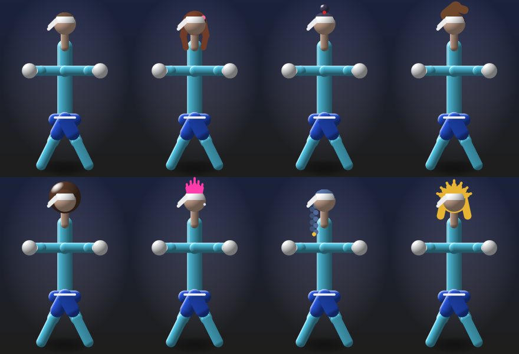

# Hair Styles & the Barber Shop



Choose your fancy. Hair styles come cheap — so do Lovers. Every fighter wears
hair in both renderers (glyph and Kitty/Sixel pixels), and every Guild opponent
has a signature style of their own.

> The `$` is **in-game money** earned by winning bouts. There is no real-money
> payment anywhere in Bayeishuui, and hair is purely cosmetic — it never changes
> combat odds.

## The catalog

| # | Style | Price | Tagline |
| --- | --- | --- | --- |
| 1 | Buzz Cut | free | Regulation. Zero fuss. |
| 2 | The Lover | $800 | Windswept and irresistible. Cheap, like love. |
| 3 | Topknot | $1500 | Samurai discipline. |
| 4 | **The Man** | **$2000** | Pay $2000 and be the man. |
| 5 | Afro | $2800 | Big. Bold. Unmissable. |
| 6 | **Punk** | **$4500** | Pay $4500 and be a Punk! |
| 7 | Dragon Braid | $6500 | A braid with a legend behind it. |
| 8 | Legend Mane | $9000 | Worn by Guild Legends. |

## Upgrades

Every style you own can be upgraded twice:

| Tier | Look | Price |
| --- | --- | --- |
| Natural | the style's natural colour | — |
| **Dyed** | vivid colour (Punk goes acid green, Lover goes hot pink…) | $500 |
| **Glow** | a shimmering colour that animates with the fight | $1500 |

Buying a style equips it. Switching between styles you own is free and keeps
each style's upgrade tier.

## Earning money

You start with $600. Each bout you win pays:

`$100 + $25 × opponent rank + $150 per arm you broke that bout` (plus a
**$1000 series bonus** for winning the 17th fight against an opponent).

A Perfect Fighter session earns money too.

## Using the Barber Shop

- Press **H** at the Player 1 select screen, or **H at any time during a bout**
  (the fight pauses while you are in the chair, in both manual and Perfect
  Fighter sessions).
- **Up/Down** (or **W/S**, **J/K**, or **1–8**) choose a style; the live
  preview shows your fighter wearing it.
- **Enter / Space** buys (if new) or equips. **U** upgrades the highlighted
  style. **Esc / Q / H / B** leaves.
- Your wallet and current style show on the STYLE row in the HUD.

## Saved profile

Your wallet, owned styles, equipped style and upgrade tiers are saved to
`~/.bayeishuui-profile` (override with the `BAYEISHUUI_PROFILE` environment
variable). It is a small text file written atomically after every purchase,
equip, upgrade and bout win. A missing or damaged file falls back to the
defaults ($600, Buzz Cut) instead of failing.

## Preview a style

```sh
make demo
./build/bayeishuui-pixeldemo --player --hair=5 --hair-level=2 --ppm=punk.ppm
# --hair=0..7   --hair-level=0 natural | 1 dyed | 2 glow
```

## Source

- `source/bayeishuui_hair.h` — catalog, colours, wallet, profile and shop rules (pure logic).
- `source/bayeishuui_barber.h` — the Barber Shop screen.
- `source/bayeishuui_sprites.h` / `source/bayeishuui_pixels.h` — glyph and pixel hair rendering.
